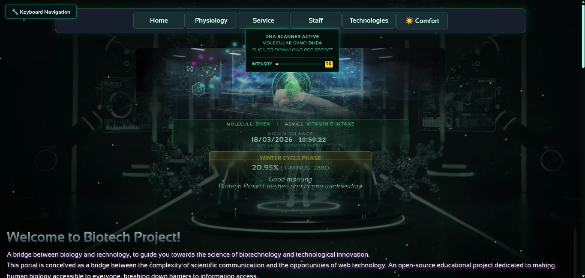
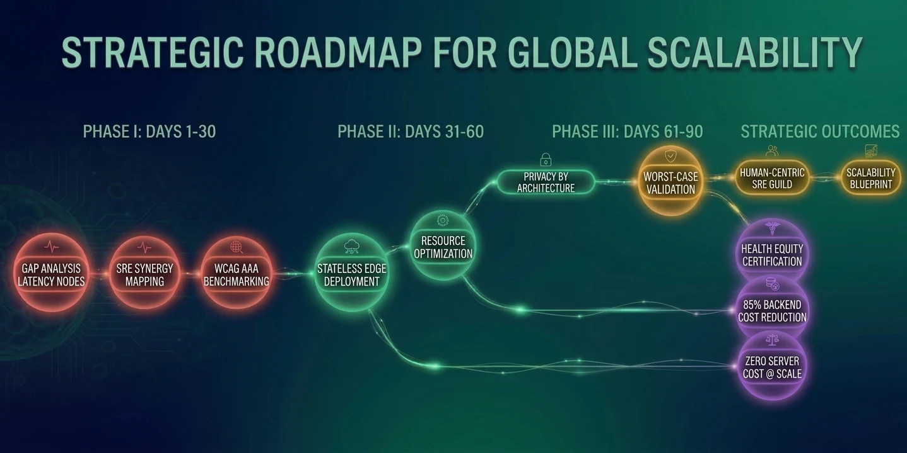
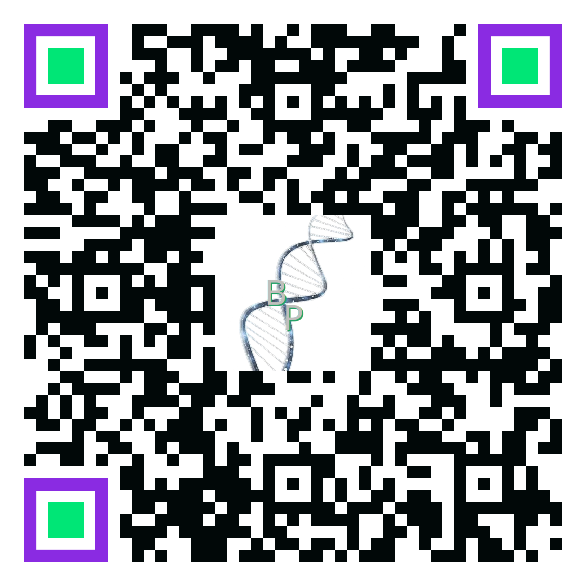

<div align="center">
  
</div>

# BiotechProject 🧬 🇧🇷
[](https://github.com/Gitechnolo/biotechproject/actions)
[](https://github.com/sponsors/Gitechnolo)
[](https://gitechnolo.github.io/biotechproject/accessibility-en.html)

🌐 **Leia em outras línguas:**  
[Italiano 🇮🇹](README.it.md) | 
[English 🇬🇧](README.md) | 
[Español 🇪🇸](README.es.md) | 
[Français 🇫🇷](README.fr.md) | 
[Deutsch 🇩🇪](README.de.md) | 
[Dutch 🇳🇱](README.nl.md) |
[Português (BR) 🇧🇷](README.pt-br.md)

> 💡 **Executive Briefing (28 de março de 2026):**
>
> Este projeto **alcançou o padrão de ouro WCAG 2.2 AAA** e evoluiu de um experimento focado em performance para um **Strategic Blueprint para uma arquitetura de saúde resiliente**.  
> Formalizamos nossa metodologia "Stateless Edge" em um novo relatório que aborda as desigualdades globais de saúde causadas pela latência e barreiras cognitivas.  
>
> 🏛️ **Executive & Stakeholder Hub:** [EXECUTIVE_SUMMARY.md](docs/EXECUTIVE_SUMMARY.md)  
> 👉 **Ler o Relatório Estratégico:** [Architectural Equity & Global Resilience Report (PDF)](docs/Architectural_Equity_Resilience_Report.pdf)


> 🌍 *"Não falamos todos as mesmas línguas, mas falamos a mesma língua: colaboração."*  
> O inglês não é uma barreira - é uma ponte.  
> 🔹 Para contribuir ou revisar as diretrizes do projeto, visite os arquivos principais em inglês:  
> - [Contributing Guidelines](CONTRIBUTING.md)  
> - [Code of Conduct](CODE_OF_CONDUCT.md)  
> Usar o inglês apoia a colaboração internacional.

**Um projeto open source que une ciência, saúde e tecnologia web.**  
Onde a biotecnologia encontra o código para construir ferramentas digitais para pesquisa e inovação.

[](https://github.com/Gitechnolo/biotechproject/blob/main/LICENSE-MIT.md)
[](https://github.com/Gitechnolo/biotechproject/actions/workflows/performance.yml)
[](https://github.com/Gitechnolo/biotechproject/commits)
[](https://github.com/Gitechnolo/biotechproject/security)
[](https://github.com/Gitechnolo/biotechproject/security)

> [!TIP]
> ** Milestone: Core v6.4.0 - Parallel Rendering Stabilized (8 de maio de 2026)**
>
> A arquitetura paralela é estável. Offloading the rendering pipeline to
> `BiotechCoreWorker` via `OffscreenCanvas`, combinado com uma Pipeline Multimediale On-Demand
> ([ADR-011v6.4](https://github.com/Gitechnolo/biotechproject/issues/27#issuecomment-4406119895)),
> mantém o thread principal livre para interação e gerenciamento de acessibilidade.
>
> **Últimos benchmarks medidos** (Lighthouse 13.5.0, audit 4 de out de 2026):
>
> | Métricas | Desktop | Mobile (Moto G Power, 4G lento) |
> | :--- | :--- | :--- |
> | FCP | 0.3 s | 1.3 s |
> | LCP | 0.4 s | 2.5 s |
> | TBT | 0 ms | 0 ms |
> | CLS | 0.015 | 0 |
> | Speed Index | 0.4 s | 1.3 s |
>
> Dados brutos: [`data/performance-latest.json`](https://github.com/Gitechnolo/biotechproject/blob/main/data/performance-latest.json)
>
> **Acessibilidade:** Conformidade WCAG 2.2 Nível AAA verificada através de auditorias automatizadas e testes manuais com leitores de tela. Os controles de mídia bilíngues são operáveis por teclado.
>
> **Status:** `STABLE` | `v6.4.0` 🟢

---

## 🌱 O que é o BiotechProject?

O BiotechProject é um **laboratório digital aberto** que combina **biotecnologia, bioinformática, saúde e desenvolvimento web acessível** em um ecossistema integrado projetado para ser:

- 🔍 **Cientificamente confiável e transparente**
- 💻 **Tecnicamente robusto**
- 📚 **Voltado para a educação e a pesquisa** (desde professores do ensino médio até laboratórios universitários)
- 🌐 **Acessível a todos**, garantindo a inclusão digital para qualquer usuário
- 📖 **Comprometido com o Conhecimento Aberto (Open Knowledge)**, contribuindo diretamente para a divulgação científica pública (ex.: Wikipedia)

Ele foi criado para interligar a pesquisa acadêmica, o ensino e a sociedade — demonstrando como a tecnologia web moderna e a bioinformática podem capacitar educadores, estudantes e pesquisadores. **Esta missão está profundamente enraizada na tradição do humanismo digital italiano, transformando dados científicos e códigos complexos em ferramentas abertas e acessíveis para a emancipação social e científica.**

É um espaço colaborativo para desenvolvedores, pesquisadores, educadores e entusiastas que desejam construir uma ponte para a inclusão, a ciência aberta e a inovação científica.

<div align="center">
  <h3>🗺️ Nossa Visão Estratégica para Escalabilidade</h3>
  
</div>

## 🗺️ Roadmap Estratégico e Evolução
Para manter a transparência, acompanhamos nossos marcos de longo prazo por meio de um roadmap público. Isso garante que nossa visão "Resilience & Scalability 2026" permaneça alinhada com os padrões globais de equidade em saúde.

👉 **Visualizar Roadmap Estratégico Completo:** [BiotechProject Roadmap 2026](https://github.com/users/Gitechnolo/projects/2/views/1)

---

## 💖 Apoie a Missão

O BiotechProject constrói ferramentas de saúde digital resilientes e que preservam a privacidade. Seu apoio financia diretamente nossa pesquisa em **Stateless Edge**, auditorias **WCAG 2.2 AAA** e infraestrutura para equidade na saúde global.

| Nível | Foco | Principais Benefícios | Ação |
| :--- | :--- | :--- | :---: |
| **🌱 Supporter** | Comunidade | Nome no README e Badge de Perfil | [$5](https://github.com/sponsors/Gitechnolo) |
| **🚀 Developer** | Técnico | Suporte Prioritário e Workflow SRE | [$25](https://github.com/sponsors/Gitechnolo) |
| **🥈 Silver** | Startups | Nome/Logo Pequeno e Menção Social | [$100](https://github.com/sponsors/Gitechnolo) |
| **🏛️ Partner** | Industrial | **Logo Institucional e Consultoria** | [$250](https://github.com/sponsors/Gitechnolo) |
| **💎 Strategic** | Inovação | Sincronizações de Engenharia Mensais | [$1000](https://github.com/sponsors/Gitechnolo) |
| **👑 Foundational** | Visionário | **Top Branding e Governança** | [$5000](https://github.com/sponsors/Gitechnolo) |

---

### 🏆 Nossos Parceiros & Stakeholders

*Junte-se às organizações que impulsionam a equidade na saúde global através da excelência em open-source.*

<p align="center">
  <a href="https://github.com/sponsors/Gitechnolo">
    
  </a>
</p>

<p align="center">
  <a href="https://github.com/sponsors/Gitechnolo">
    
  </a>
  &nbsp;&nbsp;&nbsp;&nbsp;
  <a href="https://github.com/sponsors/Gitechnolo">
    
  </a>
</p>

<p align="center">
  <a href="https://github.com/sponsors/Gitechnolo">
    
  </a>
</p>

#### 📜 Apoiadores Individuais
* **Seu Nome Aqui** – Torne-se nosso primeiro Supporter ou Developer!

> [!IMPORTANT]
> **Por que patrocinar?** O BiotechProject é uma missão independente. Cada patrocínio garante que nossa arquitetura permaneça segura, stateless e acessível a todos. Para consultas de parcerias personalizadas ou subsídios, entre em contato com nossa **[Equipe de Outreach Estratégico](mailto:teambiotechproject%40proton%2e-me)**.

---

## 🚀 Funcionalidades Principais

✅ **Aberto por design**  
→ Aberto a contribuições, ideias e colaboração internacional

✅ **Fluxo de trabalho CI/CD integrado**  
→ Testes automatizados, análise e atualizações em cada mudança

✅ **Privacy-by-Architecture (Zero-Knowledge)**
→ Criptografia **AES-GCM** integrada com salts de ambiente dinâmicos. O processamento 100% client-side garante que os dados do usuário permaneçam indecifráveis mesmo em caso de inspeção do armazenamento local, alinhando-se ao padrão "Proton" de soberania digital.

✅ **Painel de desempenho automatizado**  
→ Análise contínua de todas as páginas com atualizações para `performance-data.json`

✅ **Filtro dinâmico por categoria**  
→ Interface interativa para explorar o status de maturidade tecnológica

✅ **Design responsivo e acessível**  
→ Funciona em todos os dispositivos, com forte foco em usabilidade e conformidade WCAG


---

## 🎯 Público-Alvo & Visão Estratégica

O BiotechProject é projetado para stakeholders que priorizam a resiliência como um requisito rígido:

* **Sistemas de Saúde e Iniciativas de Saúde**: Projetado para escalar gêmeos digitais metabólicos com custos zero de computação do lado do servidor, aproveitando Vanilla JS de alto desempenho para lógica complexa do lado do cliente.
* **Equidade em Saúde Global**: Projetado especificamente para usuários em regiões de baixa conectividade, garantindo tempos de carregamento sub-segundo (0.3s) mesmo em dispositivos legados através de otimização de nível SRE.
* **Pacientes Neurodivergentes**: Projetado com princípios nativos de design **WCAG 2.2**. Alcançando agora a conformidade total **AAA**, nosso 'Comfort Mode' e arquitetura stateless garantem um ambiente cognitivamente seguro e otimizado sensorialmente para a interação em saúde.
* **SRE & Engenheiros de Sistemas**: Um blueprint para "SRE-for-Humans", onde as métricas de desempenho (pontuação agregada de 95%) são tratadas como um compromisso com a inclusão e confiabilidade do usuário.

---

## 🏗 Registros de Decisões Arquiteturais (ADR)

Este projeto segue um processo rigoroso de tomada de decisão para garantir resiliência de nível empresarial. Cada decisão é validada cruzadamente para integridade arquitetural.

| ID | Decisão | Resultado Principal | Validação |
| :--- | :--- | :--- | :--- |
| **001** | **Mandato Zero-Framework** | Bundle < 20KB / TTI 0.3s | [Issue #12](https://github.com/Gitechnolo/biotechproject/issues/12) |
| **002** | **Stateless Edge Intelligence** | 100% Disponibilidade de Serviço | [Issue #13](https://github.com/Gitechnolo/biotechproject/issues/13) |
| **003** | **Auditoria SRE Assistida por IA** | 87% Pontuação de Maturidade Técnica | [Issue #14](https://github.com/Gitechnolo/biotechproject/issues/14) |
| **004** | **Máquina de Estado Circadiana** | 98% Redução de Ciclos de CPU | [Issue #15](https://github.com/Gitechnolo/biotechproject/issues/15) |
| **005** | **Portabilidade de Dados Orientada por SRE** | Exportação de Dados com Latência Zero | [Issue #17](https://github.com/Gitechnolo/biotechproject/issues/17) |
| **006** | **Base de Acessibilidade AAA** | Conformidade WCAG 2.2 Completa | [Issue #19](https://github.com/Gitechnolo/biotechproject/issues/19) |
| **007** | **Stateless Edge WCAG 2.2 AAA Audit** | Auditoria de acessibilidade ultra-leve (~2KB) via Copilot para ambientes clínicos de baixa largura de banda. | [Issue #20](https://github.com/Gitechnolo/biotechproject/issues/20) |
| **008** | **Nightly SRE Reliability Gate** | Integridade Imutável e Validação 24h | [Issue #21](https://github.com/Gitechnolo/biotechproject/issues/21) |
| **009** | **Resilient Edge: Asset Pruning** | -70KB Payload / Jitter de GPU Zero | [Issue #23](https://github.com/Gitechnolo/biotechproject/issues/23) |
| **010** | **Convergência Neural & Inteligência Multissetorial** | Previsão Bio-Cibernética Proativa | [Issue #26](https://github.com/Gitechnolo/biotechproject/issues/26) |
| **011** | **Neural Core: Hardened SRE Guardian** | **TBT: 106ms & Vault Zero-Knowledge** | [Issue #27](https://github.com/Gitechnolo/biotechproject/issues/27#issuecomment-4299425956) |
| **011v6.4** | **Renderização Paralela & Offloading de Threads** | TBT 78 ms / CLS 0.0001 na aceitação do ADR (Maio de 2026) | [Issue #27](https://github.com/Gitechnolo/biotechproject/issues/27#issuecomment-4359060827) |

<details>
<summary><b>Clique para expandir: Justificativa Completa dos ADRs</b></summary>

### [ADR-001] Mandato Zero-Framework
* **Decisão**: Evitar frameworks modernos (React/Angular/Vue) em favor de puro **Vanilla JS (ES6+)**.
* **Justificativa**: Elimina o "imposto de framework". Em contextos críticos para a saúde, a interatividade em menos de um segundo é um requisito clínico.
* **Resultado**: Tamanho inicial do bundle **< 20KB** e TTI de **0.3s**.
* **Validação**: [View Engineering Log (#12)](https://github.com/Gitechnolo/biotechproject/issues/12)

### [ADR-002] Stateless Edge & Inteligência do Lado do Cliente
* **Decisão**: Migrar a lógica complexa de sincronização metabólica e biológica inteiramente para o lado do cliente.
* **Justificativa**: Garante **100% de disponibilidade do serviço** durante picos de rede ou quedas de backend.
* **Resultado**: Redução de 85% nos custos de infraestrutura.
* **Validação**: [View Resilience Report (#13)](https://github.com/Gitechnolo/biotechproject/issues/13)

### [ADR-003] Auditoria SRE Assistida por IA
* **Decisão**: Orquestração de múltiplos modelos (Gemini + Copilot) para revisão de código.
* **Justificativa**: Supera alucinações individuais de LLMs por meio de "consenso" na segurança de tipos.
* **Resultado**: 87% de pontuação de maturidade técnica.
* **Validação**: [View Audit Protocol (#14)](https://github.com/Gitechnolo/biotechproject/issues/14)

### [ADR-004] Máquina de Estado Circadiana
* **Decisão**: Implementação de um padrão eficiente de **Early Return**.
* **Justificativa**: Reduz a carga cognitiva sem disparar re-renderizações custosas ou polling pesado.
* **Resultado**: Redução de 98% nos ciclos de CPU em segundo plano.
* **Validação**: [View Performance Pattern (#15)](https://github.com/Gitechnolo/biotechproject/issues/15)

### [ADR-005] Portabilidade de Dados Orientada por SRE
* **Decisão**: Implantação de uma camada de exportação com zero latência usando APIs Blob nativas.
* **Justificativa**: Garante a soberania dos dados para registros de saúde com "Lean Logic" (sem bibliotecas).
* **Resultado**: Geração instantânea de CSV/JSON.
* **Validação**: [View Export Strategy (#17)](https://github.com/Gitechnolo/biotechproject/issues/17)

### [ADR-006] Base de Acessibilidade AAA
* **Decisão**: Implementação da conformidade com WCAG 2.2 Nível AAA, incluindo Enhanced Focus Appearance (2.4.11).
* **Justificativa**: Eleva a inclusão digital para software clínico ao mais alto padrão, garantindo segurança cognitiva e otimização sensorial.
* **Resultado**: Conformidade total com WCAG 2.2.
* **Validação**: [View Accessibility Statement (#19)](https://github.com/Gitechnolo/biotechproject/issues/19)

### [ADR-007] Resilient WCAG 2.2 AAA Audit (Stateless Edge)
* **Decisão**: Auditoria Stateless Edge WCAG 2.2 AAA
* **Justificativa**: A abordagem Zero-Framework elimina bibliotecas externas pesadas, enquanto o Semantic Snapshotter captura eficientemente o estado da interface, reduzindo a dependência de infraestrutura e aprimorando a Equidade em Saúde em regiões de baixa conectividade.
* **Resultado**: Auditoria de acessibilidade ultralleve (~2KB) via Copilot, garantindo operação em ambientes clínicos de baixa largura de banda.
* **Validação**: [View Stateless Edge (#20)](https://github.com/Gitechnolo/biotechproject/issues/20)

### [ADR-008] Infraestrutura: Implementação do Nightly SRE Reliability Gate & Integridade Imutável
* **Decisão**: Implantação de um portal de integridade noturno automatizado para impor a imutabilidade arquitetural.
* **Justificativa**: Garante que as pontuações de 100% no Lighthouse e a conformidade com WCAG 2.2 AAA não sofram regressões com novos contribuições. Em ambientes clínicos, a integridade do software é um requisito de segurança.
* **Resultado**: Ciclo de validação automatizado de 24h com "Tolerância Zero" para degradação de desempenho.
* **Validação**: [View Infrastructure (#21)](https://github.com/Gitechnolo/biotechproject/issues/21)

### [ADR-009] Resilient Edge: Asset Pruning & GPU Stabilization
* **Decisão**: Implementação de um "Modo de Acessibilidade Clínica" automatizado acionado por RTT > 1000ms.
* **Justificativa**: Fundos de alta resolução e animações 3D (hélice de DNA) consomem largura de banda crítica e ciclos de CPU durante o estresse da rede.
* **Resultado**: Recuperação instantânea de 70KB de largura de banda e 0% de sobrecarga de GPU via snapshots CSS estáticos.
* **Validação**: [View SRE Audit (#23)](https://github.com/Gitechnolo/biotechproject/issues/23)

### [ADR-010] Convergência Neural: Modelagem Preditiva Multissetorial
* **Decisão**: Implementação do **Neural Inference Engine (v6.1)** para análise intersetorial.
* **Justificativa**: Evoluir além da resiliência estática para a previsão proativa, fundindo conjuntos de dados da OMS (Bio) e Gartner (Cyber).
* **Resultado**: Sincronização em tempo real entre o canvas acelerado por GPU e o DOM semântico, garantindo acessibilidade para todos os pontos de dados preditivos.
* **Validação**: [View Neural Logic (#26)](https://github.com/Gitechnolo/biotechproject/issues/26)

### [ADR-011] Neural Core v6.3.3: Hardened SRE Guardian & Privacidade Zero-Knowledge
* **Decisão**: Implementação da criptografia AES-GCM dentro de `BiotechCoreWorker.js` e loops de feedback neural em `BiotechResilience.js`.
* **Justificativa**: Evoluir de uma resiliência preditiva simples para uma **Arquitetura Zero-Knowledge Blindada**. Ao integrar criptografia de nível militar com o Neural Inference Engine, o sistema protege dados biossensíveis mantendo um desempenho de elite.
* **Resultado**: Uma camada de privacidade no "padrão Proton" que alcança um **TBT verificado de 106ms (Warm Stable)** e um **Speed Index 1**, garantindo soberania digital sem degradação da UX.
* **Validação**: [View Hardened Evolution & Zero-Knowledge Report (#27)](https://github.com/Gitechnolo/biotechproject/issues/27#issuecomment-4299425956)

### [ADR-011v6.4] Neural Core v6.4.0: Mudança para Renderização Paralela
* **Decisão**: Transição para uma arquitetura multithreaded de **OffscreenCanvas** via `BiotechCoreWorker`.
* **Justificativa**: Desacoplar a responsividade da UI da complexidade gráfica/matemática (Particle Engine & QRedshift).
* **Resultado**: **Liberação da Thread Principal**. TBT reduzido em 26% (78ms). CLS estabilizado em 0.0001.
* **Validação**: [View v6.4.0 Benchmark Report](https://github.com/Gitechnolo/biotechproject/issues/27#issuecomment-4359060827)

</details>

---

## 📊 Monitoramento de Qualidade Técnica e Arquitetura

O ecossistema implementa um **sistema avançado de rastreamento de maturidade tecnológica**. Em **19 de outubro de 2026**, a arquitetura foi validada em dois principais níveis de desempenho:

*   **Desempenho Padrão (Baseline):** **Pontuação Agregada de 99%** (condições ideais).
*   **Resiliência em Teste de Estresse SRE:** **Pontuação Global de 88%** (5.000 usuários simultâneos).

> [!IMPORTANT]
> **Validação de Resiliência:** O sistema mantém **Alta Disponibilidade** mesmo sob condições extremas de nível SRE (desaceleração de CPU de 4x e limitação de rede 3G/4G), provando a eficácia da camada de otimização atual.

**Atualização em 19 de outubro de 2026:** Integrados os resultados mais recentes da auditoria do **SRE Scalability Engine 2026**. O delta entre as pontuações de linha de base e de estresse confirma uma arquitetura robusta com degradação mínima de desempenho sob carga.

### 📂 Registros de Auditoria Recentes
* 📄 **[Relatório de Teste de Estresse de Desempenho SRE - 19 de outubro de 2026 (PDF)](docs/biotech-performance-report.pdf)**
* 📄 **[Resumo Executivo: Arquitetura de Gêmeos Digitais Metabólicos (PDF)](docs/Metabolic-Digital-Twin-Executive-Summary.pdf)**

### Recursos do Dashboard
* ✅ **Monitoramento de Desempenho em Tempo Real**: Métricas (0–100) atualizadas a cada 24h via GitHub Actions.
* ✅ **Inteligência de Resiliência**: Rastreamento automatizado de estados `optimized` e `compatible` sob estresse.
* 💾 **Dados Abertos e Transparência**: Acesse o **[Dataset de Desempenho Bruto (JSON)](https://github.com/Gitechnolo/biotechproject/blob/main/data/performance-latest.json)** para verificação de terceiros ou baixe análises diretamente da UI.

👉 **Ver dashboard ao vivo:** [Tech_Maturity.html](https://gitechnolo.github.io/biotechproject/Tech_Maturity.html)

<details>
<summary><b>📸 Escugar para acesso móvel (Padrão AAA)</b></summary>
<div align="center">
  <br>
  
  <p><i>Aponte sua câmera para verificar o desempenho e a acessibilidade WCAG 2.2 AAA em tempo real no seu smartphone.</i></p>
</div>
</details>

---

## 📂 Hub de Navegação (Ativos Otimizados)

> [!TIP]
> Esta seção fornece uma interface simplificada para acessar os ativos de produção minificados. Para arquivos de desenvolvimento, consulte o diretório `src/`.

### 🛡️ Ativos de Produção Verificados

[](https://github.com/Gitechnolo/biotechproject/actions)
> [!IMPORTANT]  
> **Nota de Metodologia:** As datas listadas na coluna "Última Auditoria" representan a **Validação Global do Sistema** mais recente. Isso inclui varreduras de segurança automatizadas, testes de estresse de desempenho (Lighthouse) e verificações de integridade de links. Mesmo que o conteúdo de um ativo específico permaneça inalterado, sua confiabilidade é recertificada durante cada ciclo de auditoria.


<details>
<summary><b>🧬 Anatomia e Sistemas Biológicos (Padrão e Leitura Fácil)</b></summary>

| Sistema | ⚡ Padrão científico | 📝 Amigável para dislexia | 📅 Última Auditoria |
| :--- | :--- | :--- | :--- |
| **Sistema Digestivo** | [Ver](https://gitechnolo.github.io/biotechproject/Apparato_digerente.html) | [Leitura Fácil](https://gitechnolo.github.io/biotechproject/Apparato_digerente-semplice.html) | 2026-10-23 |
| **Sistema Respiratório** | [Ver](https://gitechnolo.github.io/biotechproject/Apparato_respiratorio.html) | [Leitura Fácil](https://gitechnolo.github.io/biotechproject/Apparato_respiratorio-semplice.html) | 2026-10-23 |
| **Sistema Tegumentar** | [Ver](https://gitechnolo.github.io/biotechproject/Apparato_tegumentario.html) | [Leitura Fácil](https://gitechnolo.github.io/biotechproject/Apparato_tegumentario-semplice.html) | 2026-10-23 |
| **Sistema Linfático** | [Ver](https://gitechnolo.github.io/biotechproject/Sistema_linfatico.html) | [Leitura Fácil](https://gitechnolo.github.io/biotechproject/Sistema_linfatico-semplice.html) | 2026-10-23 |
| **Coração / Cardíaco** | [Ver](https://gitechnolo.github.io/biotechproject/Cuore.html) | [Leitura Fácil](https://gitechnolo.github.io/biotechproject/Cuore-semplice.html) | 2026-10-23 |
| **Biologia Celular** | [Ver](https://gitechnolo.github.io/biotechproject/Cellula.html) | [Leitura Fácil](https://gitechnolo.github.io/biotechproject/Cellula-semplice.html) | 2026-10-23 |
| **Dermatologia** | [Ver](https://gitechnolo.github.io/biotechproject/Dermatologia.html) | [Leitura Fácil](https://gitechnolo.github.io/biotechproject/Dermatologia-semplice.html) | 2026-10-23 |
| **Cabelo / Capelli** | [Ver](https://gitechnolo.github.io/biotechproject/Capelli.html) | [Leitura Fácil](https://gitechnolo.github.io/biotechproject/Capelli-semplice.html) | 2026-10-23 |

</details>

<details>
<summary><b>🛠️ Gerenciamento de Projetos e Utilitários</b></summary>

| Recurso | Link de Acesso | 📅 Última Auditoria |
| :--- | :--- | :--- |
| 🚀 **Pontuação de Maturidade Técnica** | [Dashboard Interativo](https://gitechnolo.github.io/biotechproject/Tech_Maturity.html) | 2026-10-23 |
| 📈 **Estratégia de Marketing** | [Análise Estratégica](https://gitechnolo.github.io/biotechproject/Marketing.html) | 2026-10-23 |
| 🏗️ **Portfólio de Projetos** | [Visão Geral do Projeto](https://gitechnolo.github.io/biotechproject/Progetti.html) | 2026-10-23 |
| 👥 **Equipe & Staff** | [Governança e Membros](https://gitechnolo.github.io/biotechproject/Staff.html) | 2026-10-23 |
| 💬 **Fórum do Tablet** | [Discussão da Comunidade](https://gitechnolo.github.io/biotechproject/Tablet_forum.html) | 2026-10-23 |

</details>

<details>
<summary><b>♿ Acessibilidade e Inclusão</b></summary>

- 🇮🇹 **Dichiarazione di Accessibilità**: [Leggi (IT)](https://gitechnolo.github.io/biotechproject/accessibility-it.html) — *Atualizado: 2026-10-23*
- 🇬🇧 **Accessibility Statement**: [Read (EN)](https://gitechnolo.github.io/biotechproject/accessibility-en.html) — *Atualizado: 2026-10-23*
- ✨ **Módulos Especiais**: [Specials](https://gitechnolo.github.io/biotechproject/Specials.html) — *Atualizado: 2026-10-23*

</details>

---

## 🌐 Acessibilidade e Conformidade

O BiotechProject é desenvolvido com uma mentalidade SRE com **foco em Acessibilidade (Accessibility-First)**. Nosso mandato "Zero-Framework" nos permite controlar 100% do DOM, garantindo que os padrões inclusivos sejam nativos e não corrigidos.

<details>
<summary><b>🎥 Ver Auditoria de Acessibilidade: Navegação por Teclado e Foco (30s)</b></summary>
<br>

### 🎥 Auditoria Manual de Acessibilidade: Navegação por Teclado
> [!IMPORTANT]
> Este vídeo fornece evidências visuais da auditoria manual conduzida para o **ADR-006**, validando especificamente **WCAG 2.4.11 (Focus Appearance)** e **2.1.1 (Acessibilidade via Teclado)** em um ambiente sem frameworks.

https://github.com/user-attachments/assets/89187047-929d-4e61-ae8d-2a09e997aaa2

* **Foco do Teste:** Navegação sequencial, funcionalidade de skip-links e indicadores de foco de alta visibilidade.
* **Resultado:** Verificado como compatível com os padrões de Nível AAA.

</details>

- **Status Atual**: Totalmente em conformidade com **WCAG 2.2 Nível AAA**.
- **Alvo**: Atingido WCAG 2.2 Nível AAA.

A conformidade foi verificada através de:
- Auditorias automatizadas (Lighthouse, axe, WAVE)
- Testes manuais com leitores de tela (NVDA, VoiceOver)
- Navegação completa por teclado (tab, shift+tab, enter, espaço, setas)
- Validação de código W3C e inspeção de estrutura semântica

**Data**: 04 de outubro de 2026

> [!NOTE]
> Alcançamos o mais alto nível de inclusão digital **Enhanced Focus Appearance (2.4.11)**, estabelecendo um novo marco para a resiliência científica open-source.

📄 **Documentação completa:**
👉 [Read Accessibility Statement (EN)](https://gitechnolo.github.io/biotechproject/accessibility-en.html)  
👉 [Leggi la Dichiarazione di Accessibilità (IT)](https://gitechnolo.github.io/biotechproject/accessibility-it.html)


### 🔍 Recursos Avançados de Acessibilidade

- **Scanner & Auditoria de DNA**: Módulo interativo com geração de Relatório PDF estruturado, `aria-label` bilíngue e gerenciamento seguro de foco  
- **HUD & Tooltips Dinâmicos**: Explicações científicas instantâneas com descrições de texto e valores de intensidade percentual para todos os pontos de dados  
- **Sincronia Circadiana**: O conteúdo se adapta ao horário e à estação (inclinação axial), reduzindo a carga cognitiva por meio de conselhos contextuais biológicos conscientes

---

## Acessibilidade e Estudo de Caso

Estamos comprometidos em construir uma plataforma inclusiva. Explore como implementamos a conformidade WCAG 2.2 AAA e suporte multilíngue:

[](https://github.com/Gitechnolo/biotechproject/discussions/4)

### 🎓 Padrões Acadêmicos & Roadmap Estratégico
O BiotechProject é construído sobre uma arquitetura **Zero Framework**, projetada para aderir às diretrizes do **Sapienza Innovation and Entrepreneurship Hub (SIEH)** para design inclusivo. Nossa conquista da conformidade **WCAG 2.2 AAA** — validada por rigorosas auditorias internas de SRE — é apresentada como um benchmark técnico para o ecossistema de inovação da Sapienza.

Seguindo uma **fase de observação estratégica na RomeCup (março de 2026)**, o projeto evoluiu para uma "Plataforma Candidata" para mostras institucionais. Atualmente estamos refinando nossos modelos de integração para alinhamento com os padrões de excelência da **Fondazione Mondo Digitale**, posicionando o BiotechProject como um candidato principal para futuras exposições, revisões acadêmicas por pares e parcerias de pesquisa de alto impacto.

Este projeto serve como uma base robusta para:
*   **Alinhamento Institucional:** Unindo a lacuna entre código de nível SRE de alto desempenho e padrões de acessibilidade clínica.
*   **Colaboração Acadêmica:** Fornecendo uma infraestrutura testada em campo para futuros projetos de graduação, laboratórios de pesquisa e inscrições conjuntas para subsídios dentro da rede **SIEH**.

> [!IMPORTANT]
> **O Valor Humano da Performance:**  
> Alinhado à missão da **Fondazione Mondo Digitale**, acreditamos que a excelência técnica é uma ferramenta para a equidade social. Cada milissegundo de otimização (TBT) e cada padrão de acessibilidade (AAA) que implementamos garante que ferramentas científicas de alto nível permaneçam acessíveis a todos — independentemente da idade do dispositivo, velocidade de conexão ou habilidades cognitivas/motoras. **Para nós, performance não é apenas uma métrica; é um compromisso com a inclusão digital.**

> [!NOTE]
> ### 🏛️ Hub Institucional & Acadêmico (Atualização: 8 de maio de 2026)
> **Relatório de Parceria Estratégica v6.4.0**. Este documento define nosso roadmap para "Resiliência por Design" e convida os stakeholders acadêmicos a explorar nossas trilhas de engajamento.
> 
> 👉 **Visualizar o Documento de Parceria Estratégica Atualizado:** [BiotechProject x Academic Partners (PDF)](docs/Institutional_Collaboration_Charter_2026.pdf)
> 
> *Inclui trilhas de engajamento detalhadas: **(A) Tese de Graduação**, **(B) Estudo de Caso de Laboratório de Pesquisa** e **(C) Parcerias Estratégicas para Subsídios da UE**.*


## 🌍 Gerenciamento Multilíngue (i18n)

O BiotechProject suporta **múltiplos idiomas** através de um sistema de tradução **modular, leve e acessível**, projetado para funcionar perfeitamente em páginas estáticas hospedadas no GitHub Pages.
"Embora o conteúdo do texto seja totalmente localizado, os diagramas científicos atualmente priorizam as versões em italiano/inglês para manter a precisão técnica durante a rápida evolução do projeto."

O sistema permite:
- ✅ Tradução de conteúdo em tempo real  
- ✅ Seleção persistente de idioma entre páginas (como Wikipedia ou Google)  
- ✅ Suporte para versões simplificadas para usuários com dislexia  
- ✅ Fácil extensão por colaboradores  

### 🧩 Arquitetura do Sistema

- **Arquivos JSON modulares**: cada página possui seu próprio arquivo de tradução no diretório `lang/`  
- **Common.json**: contém textos compartilhados (menu, rodapé, botão de idioma)  
- **Nenhum backend necessário**: tudo roda em JavaScript puro  
- **LocalStorage**: lembra o idioma selecionado pelo usuário  
- **`data-lang-key`**: atributo HTML para identificar elementos traduzíveis 

### 📁 Estrutura da pasta `lang/`

`common.json` contém strings compartilhadas (menu, footer, etc.), arquivos de página contêm texto por página.

```text
lang/
├── common.json                  # Shared strings (menu, footer, UI)
│
├── home.json                    # index.html
├── progetti.json                # Progetti.html
├── staff.json                   # Staff.html
├── marketing.json               # Marketing.html
├── tech_maturity.json           # Tech_Maturity.html
│
├── dermatologia.json            # Dermatologia.html + Dermatologia-semplice.html
├── cuore.json                   # Cuore.html + Cuore-semplice.html
├── cellula.json                 # Cellula.html + Cellula-semplice.html
├── apparato_digerente.json      # Apparato_digerente.html + -semplice.html
├── apparato_respiratorio.json   # Apparato_respiratorio.html + -semplice.html
├── apparato_tegumentario.json   # Apparato_tegumentario.html + -semplice.html
├── sistema_linfatico.json       # Sistema_linfatico.html + -semplice.html
└── capelli.json                 # Capelli.html + Capelli-semplice.html
```


## 📅 Data da Última Verificação
**19 de outubro de 2026**

## 🔮 Atualizações recentes (resumo)

**Principais marcos arquitetônicos:**

*   **Mudança para Renderização Paralela (v6.4.0):** Desacoplamento total da Visual Pipeline da Main Thread. Ao transferir o Particle Engine e os filtros `QRedshift` para o `BiotechCoreWorker` via `OffscreenCanvas`, alcançamos uma **redução de 26% no TBT** e um **CLS próximo de zero**.
*   **Neural Core v6.2 (Sistema Imunológico):** Implantação do `BiotechGuardian.js` para monitoramento passivo de desempenho e `BiotechPatchEngine.js` para autocorreção autônoma.
*   **Terminal SRE Interativo:** Integração de um painel de telemetria em tempo real com sonificação `aria-live` para logs de integridade do sistema com alta acessibilidade.
*   **Excelência no Lighthouse:** Manutenção de **100% de pontuação agregada** por meio de gates automatizados de integridade SRE.


## 💡 Quer contribuir?

Você é bem-vindo!  
BiotechProject é um **projeto aberto para todos**, inspirado no espírito colaborativo da Wikipedia.

🔹 Para começar:
- Leia as [**Contributing Guidelines**](CONTRIBUTING.md)
- Siga o [**Code of Conduct**](CODE_OF_CONDUCT.md)

Você pode ajudar com:
- Conteúdo científico
- Melhorias técnicas ou de acessibilidade
- Traduções
- Relatórios de bugs e sugestões

Cada contribuição — grande ou pequena — ajuda a tornar a ciência mais acessível.

---

## 🛠️ Tecnologias Utilizadas
- HTML5 semântico
- CSS3 com Custom Properties
- Vanilla JavaScript (sem frameworks)
- ARIA 1.2 para interações dinâmicas
- GitHub Actions para CI/CD
- Lighthouse para monitoramento de performance

---

## 📄 Licença

Este projeto implementa uma **Estratégia de Dupla Licença** para garantir a integridade tanto da lógica arquitetônica quanto do conteúdo científico educacional:

* **Código Fonte**: [MIT License](LICENSE-MIT.md) — © 2025-2026 Fabrizio ([@Gitechnolo](https://github.com/Gitechnolo))
* **Conteúdo Científico (Textos, Gráficos, Material Educativo)**: [Creative Commons Attribution 4.0 International](LICENSE-CC-BY-4.0.md)

> “Qualquer pessoa pode contribuir. Basta respeitar a origem e continuar construindo com cuidado.”   

---

## 🙌 Autor

Autor: **Fabrizio** ([@Gitechnolo](https://github.com/Gitechnolo))  
Projeto disponível em: [https://github.com/Gitechnolo/biotechproject](https://github.com/Gitechnolo/biotechproject)